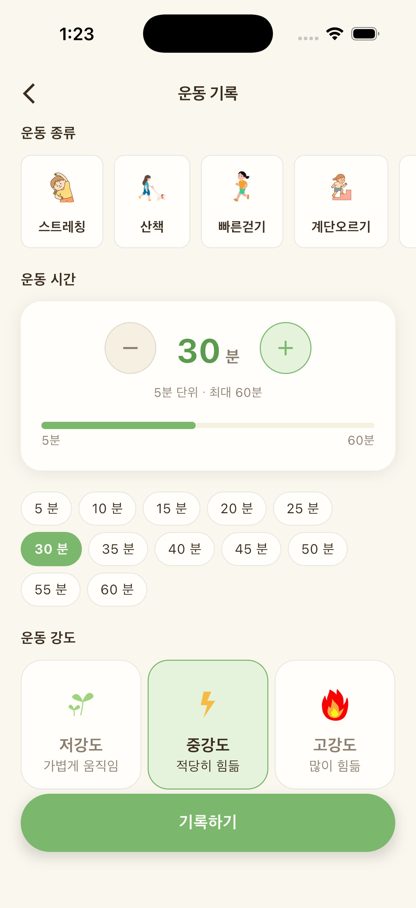

연말이 되면 일도 약속도 몰려서 운동 30분을 따로 떼어 내기가 정말 어려워요. "오늘은 못 했으니 내일 제대로 하자"가 며칠째 이어지기도 하죠. 그런데 점심 먹으러 가기 전에 계단 두 층을 빠르게 오르는 1분도 운동으로 칠 수 있을까요. 연구자들은 이런 걸 "운동 간식(exercise snacks)"이라고 불러요. 정말 의미가 있는지, 이번 주 이틀만 내서 내 그래프로 확인해 보면 어떨까요.

## 운동 간식이 뭔지부터

운동 간식을 연구해 온 캐나다 연구진은 이를 "하루 동안 틈틈이 하는, 1분 이내의 짧고 힘찬 운동"으로 정의했어요. 계단을 빠르게 오르거나, 제자리에서 힘 있게 걷거나, 의자에서 일어났다 앉기를 반복하는 식이에요. 운동복으로 갈아입거나 헬스장에 갈 필요가 없어서 바쁜 날에도 끼워 넣기 쉬워요.

연구진은 운동 간식이 시간 부담이 적고 오래 앉아 있는 생활의 영향을 줄이는 데 도움이 될 수 있다고 보면서도, 아직은 소규모 연구 위주라 더 많은 연구가 필요하다고 덧붙였어요.

## 왜 하필 식사 전일까

밥을 먹으면 탄수화물이 포도당이 되어 혈액으로 들어와요. 이때 근육은 포도당을 받아서 쓰거나 저장하는 큰 창고예요. 근육이 수축하면 인슐린의 도움과는 별개로도 포도당을 끌어들이는 통로가 열린다고 알려져 있어요. 오래 가만히 있으면 창고 문이 반쯤 닫힌 채로 시간이 흐르고, 1분이라도 힘 있게 움직이면 문을 한 번 활짝 여는 셈이에요.

이 아이디어를 시험한 연구가 있어요. 2014년 뉴질랜드 연구진은 인슐린 저항성이 있는 성인 9명에게 세 끼 식사 30분 전에 1분씩 6번, 경사진 러닝머신을 빠르게 걷게 했어요. 그리고 하루 한 번 30분 동안 중간 강도로 꾸준히 걸은 날과 비교했어요. 그 결과 운동 간식을 한 날 아침과 저녁 식후 혈당 흐름이 더 완만했고 24시간 평균 혈당도 낮은 쪽으로 나타났어요. 걷기와 근력 동작을 섞은 운동 간식도 비슷한 경향이었고요. 다만 9명뿐인 짧은 연구라서, 모두에게 같은 결과가 나온다고 말하기는 어려워요. 그래서 내 몸으로 확인해 보는 게 더 재미있어요.

## 실험 설계, 메뉴가 비슷한 이틀

연속혈당측정(CGM)을 쓰고 있다면 이렇게 해 보세요.

1. 점심 메뉴가 비슷한 평일 이틀을 골라요. 회사 식당 백반이나 늘 가는 김밥집처럼 메뉴를 맞추기 쉬운 날이 좋아요.
2. 첫째 날은 평소대로 지내요. 점심 전에 따로 움직이지 않아요.
3. 둘째 날은 점심 먹기 30분쯤 전에 1분 운동 간식을 해요. 계단 두 층, 의자에서 일어났다 앉기 10~15회, 제자리 빠르게 걷기 중 하나면 충분해요.
4. 두 날 모두 식사 시작 시각을 기록하고, 식후 2시간 동안은 비슷하게 지내요. 한쪽 날만 식후 산책을 하면 비교가 흐려져요.

허벅지와 엉덩이처럼 큰 근육을 쓰는 하체 동작이 좋아요. 짧아도 많은 근육이 함께 일하기 때문이에요.

## 실험이 흐려지기 쉬운 순간

막상 해 보면 조건을 맞추기가 생각보다 어려워요. 둘째 날만 반찬을 더 먹었거나, 첫째 날만 점심 뒤 회의실까지 먼 길을 걸었다면 그 차이가 그래프에 섞여요. 전날 잠을 설친 날도 비교에서 빼는 게 좋아요. 그래서 메모장에 날짜, 메뉴, 식사 시작 시각, 운동 간식 종류, 식후에 한 일을 한 줄씩 적어 두세요. 나중에 그래프를 볼 때 "이날은 왜 달랐지?"에 답해 줘요.

## 그래프는 이렇게 비교해요

두 날의 점심 식후 곡선을 나란히 놓고 세 가지를 보세요.

- 오르막이 얼마나 가파른지
- 꼭대기가 얼마나 높은지
- 꼭대기에서 제자리까지 얼마나 걸리는지

사람마다 다르지만 운동 간식을 한 날 오르막이 조금 완만하거나 꼭대기가 낮게 보일 수 있어요. 차이가 거의 없을 수도 있어요. 그날의 잠, 스트레스, 반찬 하나 차이로도 곡선은 달라지니, 한 번으로 결론 내리기보다 몇 번 반복해 보면 경향이 보여요. 계단 오르기나 빠르게 걷기도 운동 기록에 남겨 두면 나중에 그래프와 맞춰 보기 쉬워요.

*글루밍 운동 기록 화면 (예시)*

## 숨이 찰 만큼 해야 하냐고 묻는다면

연구에서는 꽤 힘찬 강도를 썼지만 처음부터 그럴 필요는 없어요. 평소 운동을 거의 안 했다면 조금 숨이 가빠지는 정도에서 시작하고, 몸이 익숙해지면 강도를 올려도 늦지 않아요. 운동 간식은 길게 운동하는 시간을 대신하기보다, 그런 시간이 없는 날의 빈틈을 메우는 쪽에 가까워요. 시간이 나는 날엔 산책이나 근력운동을, 바쁜 날엔 운동 간식을 하면 흐름이 끊기지 않아요.

실험이 끝나도 계속하고 싶다면 신호를 정해 두세요. 전자레인지가 돌아가는 동안 제자리 걷기, 회의 들어가기 전 일어났다 앉기, 양치하며 벽 짚고 까치발 들기 20회처럼요. 하루 세 번만 해도 3분이에요.

임신 중이거나, 혈당에 영향을 주는 약을 복용 중이거나, 관절이나 심장 등 건강상 주의가 필요하다면 강도를 올리기 전에 담당 의료진과 먼저 상의해 주세요. 어지럽거나 가슴이 답답하면 바로 멈추고 쉬어요. 1분이 부담스러운 날엔 30초여도 괜찮아요.
