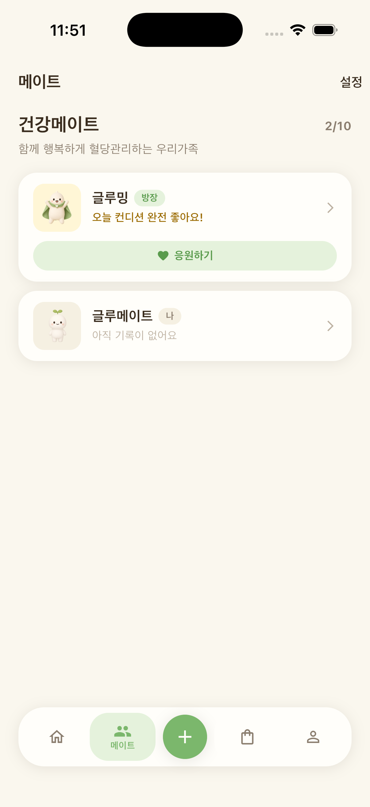

식단을 바꾸려는데 가족은 늘 먹던 대로 먹고, 산책을 나가려는데 혼자라 귀찮고. 혈당 관리가 유독 힘든 이유 중 하나는 혼자 하기 때문일지도 몰라요.

## 함께일 때 오래 가요

미국당뇨병학회(ADA)의 생활습관 지침은 혈당 관리를 개인의 의지만으로 보지 않아요. 생활습관을 바꾸고 이어가는 데 가족과 주변의 지지, 정서적인 건강이 중요하다고 함께 다뤄요.

식사와 움직임은 가족과 함께하는 시간이기도 해요. 같은 식탁, 같은 저녁 산책을 나누면 따로 애쓰지 않아도 습관이 자연스럽게 이어져요.

## 가족과 함께 할 수 있는 작은 습관

1. 저녁 식사 후 다 같이 10분 산책. 끼니 후 짧게 걷는 습관은 식후 혈당 흐름과 관련이 있다는 연구가 있어요. 가족 모두에게 좋은 저녁 루틴이 돼요.
2. 식탁에 채소 반찬 먼저 올리기. 모두가 채소부터 먹는 식탁이면 나만 따로 먹지 않아도 돼요.
3. 장 보러 같이 가기. 단 음료와 과자를 덜 담고, 제철 채소와 과일을 함께 골라요.
4. 잔소리 대신 응원. "그거 먹으면 안 되잖아"보다 "같이 걸을까?"가 오래 가요.

## 멀리 사는 가족과도

부모님과 떨어져 산다면, 오늘의 컨디션을 서로 나누는 것부터 시작해 보세요. 글루밍의 메이트 기능으로 가족을 초대하면 서로의 오늘을 글루밍즈의 표정으로 먼저 알고, "오늘도 화이팅이에요!", "같이 걸을까요?" 같은 응원을 톡 보낼 수 있어요.

*글루밍 메이트 화면 (예시)*

혈당 관리는 숫자와의 싸움이 아니라 매일의 생활이에요. 그 생활을 함께 나눌 사람이 있다면, 훨씬 가볍게 오래 갈 수 있어요.
