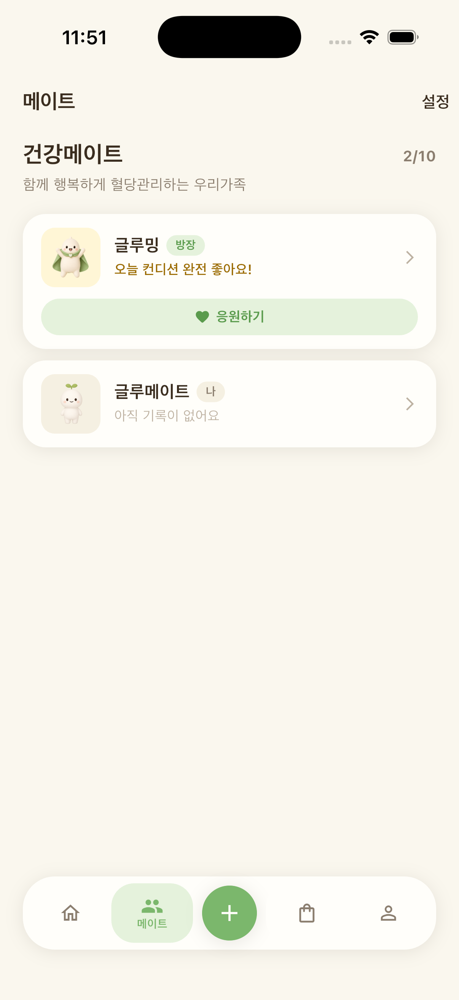

식탁 한쪽에 내 몫의 잡곡밥과 나물, 다른 쪽엔 가족이 먹는 볶음밥과 튀김. 저녁 먹고 산책을 나가려는데 다들 소파에 누워 있어서 슬그머니 운동화를 다시 벗게 돼요. 혈당 관리가 유독 힘든 이유는 어쩌면 혼자 하고 있어서일지도 몰라요. 반대로 식탁과 저녁 시간을 함께 쓰는 사람들이 같은 방향을 보면, 따로 애쓰지 않아도 습관이 굴러가기 시작해요. 가족과 혈당 관리 사이에 흔히 끼어드는 오해 다섯 가지를 하나씩 풀어 볼게요.

## 오해 하나, "결국 내 의지 문제예요"

우리가 먹는 음식은 대부분 집에 있는 음식이에요. 냉장고에 탄산음료가 있으면 손이 가고, 식탁에 나물이 있으면 한 젓가락 더 먹게 되죠. 혼자 산책을 나가려면 마음을 단단히 먹어야 하지만, 가족이 현관에서 기다리고 있으면 신발 신기가 훨씬 쉬워요.

미국당뇨병학회(ADA)의 생활습관 지침도 혈당 관리를 개인의 의지만으로 보지 않아요. 생활습관을 바꾸고 이어가는 데 가족과 주변의 지지, 정서적인 건강이 중요하다고 함께 다루고, 관리가 버겁게 느껴지는 마음이나 혼자 짊어진 듯한 부담도 살펴야 할 부분으로 봐요.

## 오해 둘, "가족한테 피해 주지 않게 내 것만 따로 차리면 돼요"

따로 차린 밥상은 금방 지쳐요. 매 끼니 두 번 차리는 수고도 크지만, 무엇보다 '나만 참는다'는 느낌이 쌓이거든요. 가족 모두가 같은 밥상에서 조금씩 바꾸는 쪽이 오래 가요.

- 식탁에 채소 반찬을 먼저 올려 모두 채소부터 먹기
- 장 볼 때 함께 가서 단 음료와 과자는 덜, 제철 채소와 과일은 더 담기
- 냉장고 눈높이 칸에 탄산음료 대신 보리차와 손질한 채소 두기
- 주말 한 끼는 같이 요리하기. 잡곡밥 짓기, 쌈 채소 씻기처럼 아이도 할 수 있는 일로

내 몸을 위해 시작한 변화가 가족 모두의 밥상을 바꾸는 계기가 되기도 해요. 같은 식탁에서 같은 반찬을 먹으면 따로 설명하지 않아도 되고, 가족도 모르는 사이에 채소 한 젓가락을 더 먹게 돼요. 메뉴를 하나 바꿀 때마다 "이번 주엔 이걸 해 볼게"라고 가볍게 알려 주면 가족도 덜 낯설어해요.

## 오해 셋, "산책은 혼자 하나 같이 하나 똑같죠"

걷는 건 같아도 이어지는 힘이 달라요. 2형 당뇨가 있는 성인을 대상으로 한 연구에서는 하루 한 번 30분을 걷는 것보다 매 끼니 후 10분씩 걷는 쪽이 식후 혈당 흐름이 더 완만한 것과 관련이 있었어요. 특히 저녁 식사 뒤 걷기에서 차이가 두드러졌다고 해요.

그런데 저녁은 가족이 가장 많이 모이는 시간이에요. 아이와는 놀이터까지, 부모님과는 동네 한 바퀴. 혼자라면 건너뛰기 쉬운 10분이 가족 루틴이 되면 따로 애쓰지 않아도 굴러가요. 비가 오는 날엔 아파트 복도나 계단을 함께 오르내리는 것도 방법이에요. 중요한 건 거리보다 "밥 먹고 나면 다 같이 움직인다"는 우리 집만의 약속이에요. 채소 반찬부터 먹고 저녁 뒤에 함께 걷는 모습을 보고 자란 아이에게는 따로 가르치지 않아도 저녁 산책이 당연한 일상이 되고요.

## 오해 넷, "도와준다는 건 잘 챙겨 묻는 거예요"

가족 중 누군가 혈당을 관리하고 있으면 걱정이 잔소리로 바뀌기 쉬워요. "그거 먹으면 안 되잖아", "오늘 혈당 몇이었어?" 같은 말은 마음은 고마워도 듣는 사람을 지치게 해요. 먹는 것을 지적하기보다 같은 메뉴를 함께 먹고, "같이 걸을까?"라고 먼저 말해 주는 쪽이 훨씬 힘이 돼요. 숫자 대신 "오늘 컨디션 어때?"라고 묻고, 버겁다는 이야기를 들었다면 해결책보다 먼저 들어 주세요. 곁에서 같은 편이 되어 주는 것만으로도 큰 힘이 돼요.

관리하는 쪽이라면 무엇이 도움이 되는지 구체적으로 말해 주는 것도 좋아요. "과자 사 오지 마"보다 "저녁 먹고 같이 걸어 줄래?"처럼 함께 할 수 있는 부탁이 서로 마음 편해요. 가족은 내 사정을 다 알지 못할 때가 많아서, 작은 부탁 하나가 생각보다 큰 변화를 만들기도 해요.

## 오해 다섯, "멀리 사는 가족과는 함께할 게 없어요"

부모님과 떨어져 산다면 매일 "혈당은 어땠어요?"라고 묻기보다 "오늘 몇 걸음 걸으셨어요?", "저도 점심 먹고 걸었어요"처럼 가볍게 나누는 이야기가 오래 가요. 같은 시간에 각자 동네를 걷고 사진을 주고받는 것도 멀리서 함께하는 방법이에요. 부모님이 걸은 동네 사진 한 장이 오면, 그날의 안부를 따로 묻지 않아도 마음이 놓이기도 하고요.

글루밍의 메이트 기능으로 가족을 초대하면 서로의 오늘을 글루밍즈의 표정으로 먼저 알고, "오늘도 화이팅이에요!", "같이 걸을까요?" 같은 응원을 톡 보낼 수 있어요.

*글루밍 메이트 화면 (예시)*

혈당 관리는 숫자와의 싸움이 아니라 매일의 생활이고, 생활은 원래 함께 사는 사람들과 나누는 거예요. 내가 먼저 바뀌면 가족이 따라오기도 하고, 가족이 먼저 손을 내밀어 주기도 해요. 어느 쪽이든 혼자 할 때보다 훨씬 가볍게, 오래 갈 수 있어요. 오늘 저녁, "밥 먹고 잠깐 걸을까?" 한마디부터 건네 보세요.
