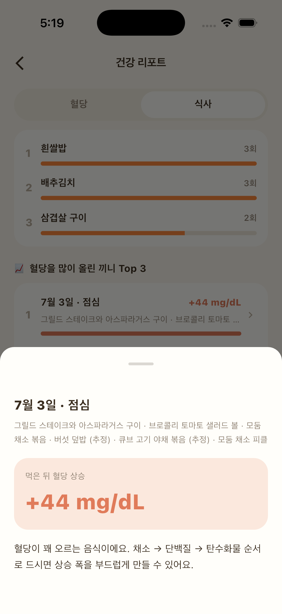

식단을 바꾸는 건 생각보다 어려워요. 좋아하는 메뉴를 끊어야 할 것 같으니까요. 그런데 메뉴는 그대로 두고 먹는 순서만 바꾸는 방법도 있어요.

## 연구에서는 무엇을 봤을까

미국 웨일코넬 의대 연구팀은 2형 당뇨가 있는 성인들에게 같은 식사(빵, 오렌지주스, 닭가슴살, 채소 샐러드)를 두 가지 순서로 먹게 했어요.

- 하루는 탄수화물을 먼저, 15분 뒤 단백질과 채소를
- 다른 날은 채소와 단백질을 먼저, 15분 뒤 탄수화물을

그 결과 채소와 단백질을 먼저 먹은 날에 식후 혈당과 인슐린이 덜 오르는 경향이 관찰됐어요. 먹은 음식의 종류와 양은 같았는데도요.

규모가 작은 연구라서 모든 사람에게 똑같이 나타난다고 말할 수는 없어요. 다만 부담 없이 시도해 볼 수 있다는 점에서 많이 이야기되는 방법이에요.

## 식탁에서 해볼 수 있는 순서

1. 채소·나물 반찬 먼저. 샐러드, 나물, 쌈 채소를 첫 젓가락으로.
2. 단백질 반찬 다음. 생선, 두부, 달걀, 고기.
3. 밥·면·빵은 마지막에. 이미 어느 정도 배가 찬 상태라 양 조절에도 도움이 돼요.

한식은 밥과 반찬을 번갈아 먹는 게 익숙해서 처음엔 어색할 수 있어요. 첫 몇 숟가락만 순서를 바꾸는 것부터 시작해 보세요.

## 내 몸에서도 그럴까

CGM을 쓰고 있다면 같은 메뉴를 두 가지 순서로 먹어 보고 식후 흐름을 견줘 보세요. 글루밍 리포트에서는 끼니별 상승 폭과 함께 먹는 순서에 대한 안내도 볼 수 있어요.

*글루밍 리포트의 끼니 상세 화면 (예시)*

혈당에 영향을 주는 약을 드시고 있다면, 식사 방식을 바꾸기 전에 담당 의료진과 먼저 상의해 주세요.
