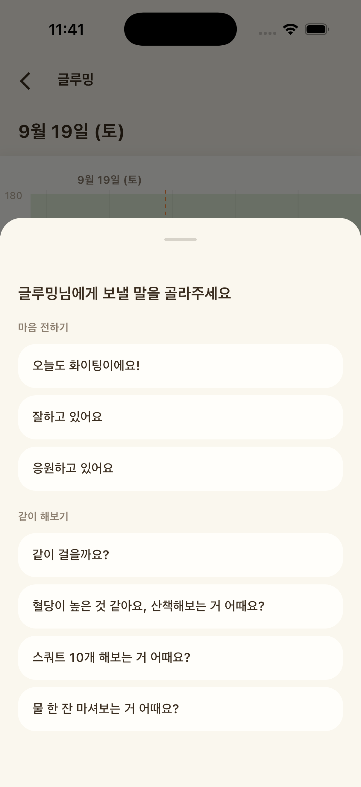

새 운동화를 사고 식단 앱을 깔았는데, 일주일쯤 지나니 슬그머니 흐지부지된 적 있으시죠. 의지가 약해서가 아니에요. 혼자 할 때는 "오늘 하루쯤 빠져도 아무도 모르는" 날이 생기기 마련이거든요.

그런데 누군가와 함께하면 하루의 모양이 조금 달라져요. 친구와 2주짜리 걷기 챌린지를 시작한 직장인의 크리스마스 하루를 따라가 볼게요.

## 오전 7시 반, 출근길에 온 알림 하나

지하철에서 휴대폰을 보니 친구가 벌써 아침 산책을 마쳤다는 알림이 와 있어요. 별말 없이 걸음 수만 찍힌 화면인데, 이상하게 "나도 한 정거장 먼저 내려 볼까" 하는 마음이 들어요.

함께하기의 첫 번째 장치는 이렇게 서로의 기록이 보이는 거예요. 누가 시키지 않아도, 친구가 움직인 흔적이 내 다음 행동의 신호가 돼요.

멀리 사는 친구라도 괜찮아요. 같은 동네가 아니면 함께 걸을 수는 없지만, 걸은 사진 한 장, 걸음 수 화면 하나를 주고받는 것만으로도 "오늘도 하고 있구나"가 전해져요. 혈당을 신경 쓰기 시작한 지 얼마 안 됐다면 혼자 정보를 찾고 혼자 참는 시간이 길어지기 쉬운데, 같은 고민을 나눌 친구가 한 명만 있어도 "나만 이런 게 아니구나" 하는 안도감이 생겨요.

## 낮 12시 40분, 회사 앞 10분 산책

점심을 먹고 나니 자리로 돌아가 눕듯 앉고 싶어요. 그때 옆자리 동료가 "한 바퀴만 돌고 들어가요" 하고 먼저 일어나요. 어제 말해 둔 약속이에요.

약속은 피곤한 날에도 일어날 이유를 하나 더 만들어 줘요. 1999년 미국에서 체중 관리 프로그램에 참여한 166명을 살펴본 연구가 있어요. 혼자 신청한 사람들과, 친구나 가족 세 명과 함께 신청한 사람들로 나눠 비교했어요. 친구와 함께 들어와 서로를 돕는 활동까지 한 그룹은 95%가 프로그램을 끝까지 마쳤고, 혼자 들어와 기본 프로그램만 한 그룹은 76%였어요. 프로그램이 끝난 뒤 몇 달 동안 줄인 체중을 유지한 비율도 함께한 그룹에서 더 높게 나타났어요.

## 오후 3시, 탕비실 앞에서 고른 음료

오후가 되면 달달한 라떼가 생각나요. 이번 주 챌린지에는 "단 음료 쉬기"도 있어서, 친구에게 "오늘은 보리차로 버팀" 하고 사진을 보내요. 답장은 박수 이모티콘 하나지만 그걸로 충분해요.

혈당 수치까지 나눌 필요는 없어요. 혈당 이야기를 꺼내기가 망설여진다면 "요즘 단 음료 줄이는 중이야, 같이 할래?"처럼 행동만 나눠도 돼요.

## 저녁 7시, 크리스마스 저녁 약속

오랜만에 친구들과 만나는 저녁이에요. 브런치나 저녁 약속 전에 30분 먼저 만나 동네를 걷기로 했어요. 걷다 보면 이야기는 이미 시작되고, 식당에 들어설 때쯤엔 배고픔도 조금 차분해져 있어요.

식탁에서는 누군가 "첫 젓가락은 나물부터" 하고 웃으며 말해요. 혼자였다면 잊었을 작은 규칙이, 같이 있으니 놀이처럼 지켜져요. 힘든 날 "괜찮아, 내일 또 하자"는 한마디가 그만두지 않게 붙잡아 주는 것처럼, 즐거운 날엔 같이 웃는 것 자체가 다음에도 하고 싶은 이유가 돼요.

## 밤 10시, 오늘 걸음 수 겨루기

집에 와서 챌린지 화면을 열어 보니 오늘은 친구가 근소하게 이겼어요. 내일은 꼭 이기고 싶어져요.

2019년 미국 STEP UP 연구에서는 성인 602명이 웨어러블 기기로 걸음 수를 기록하며 24주 동안 걷기 게임에 참여했어요. 서로 응원하는 방식, 팀으로 협력하는 방식, 서로 겨루는 방식으로 나눠 봤더니, 세 방식 모두 게임을 하지 않은 그룹보다 걸음 수가 늘었어요. 그중 겨루는 방식에서 차이가 가장 컸고, 게임이 끝난 뒤 석 달 동안에도 차이가 뚜렷하게 남은 것도 겨루는 방식이었어요.

두 연구 모두 혈당을 직접 본 건 아니에요. 다만 혈당 관리도 결국 걷기와 식사 같은 생활습관을 오래 이어 가는 일이라, "함께하면 오래 간다"는 결과는 참고할 만해요.

친구가 나보다 훨씬 잘해서 의욕이 꺾인다면, 절대 숫자 대신 "지난주의 나보다 얼마나 늘었는지"로 겨뤄 보세요. 출발점이 달라도 공평해요. 겨루기가 부담스러운 사이라면 둘이 합쳐 하루 2만 보 같은 공동 목표나, 기록만 보여 주고 응원하는 방식도 있어요.

## 밤 11시, 잠들기 전 보내는 한마디

글루밍에서 메이트로 친구를 초대해 두면, 서로의 오늘 컨디션을 글루밍즈의 표정으로 먼저 알 수 있어요. 오늘 잘 챙긴 것 같으면 "잘하고 있어요", 바빠 보였다면 "같이 걸을까요?"를 톡 보내요. 수치를 묻지 않아도 마음은 전해져요.

*글루밍 응원 보내기 화면 (예시)*

챌린지를 오래 이어 가려면 몇 가지만 정해 두면 돼요. 기간은 1~2주로 짧게 잡고 끝나면 새로 고르기, 이긴 사람이 커피 한 잔 고르기 정도의 작은 보상, 누군가 아프거나 바쁜 주엔 쉬어 가기. 이 세 가지면 한 사람이 빠져도 챌린지 전체가 무너지지 않아요.

올해 마지막 주를 함께할 친구가 떠오르셨나요? 혼자 하던 일이 둘이 되면, 생각보다 훨씬 가벼워져요.
