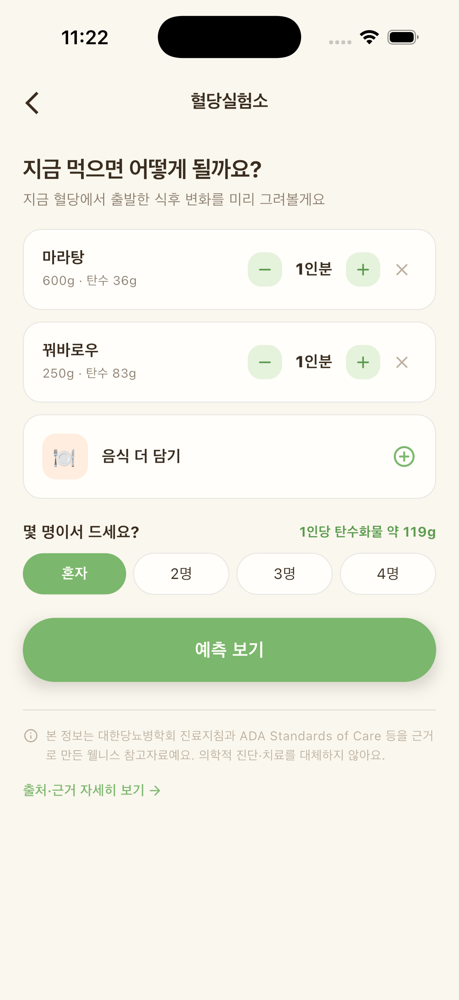

크리스마스이브 저녁, 빵집 앞 줄은 유난히 길어요. 케이크 상자를 받아 들고 집에 오는 길에 이런 말들이 떠오르죠. "생크림은 지방이니까 혈당엔 괜찮대", "딸기 케이크면 그나마 낫지 않아?", "오늘 먹고 내일 굶으면 되지."

다 그럴듯하게 들리지만, 하나씩 들여다보면 조금씩 어긋나 있어요. 1년에 한 번 있는 날이니 케이크를 피할 필요는 없어요. 다만 어떤 말을 믿고 먹느냐에 따라 그래프의 모양은 꽤 달라질 수 있어요.

## "생크림은 지방이라 혈당은 별로 안 올린다"

반만 맞는 말이에요. 생크림과 버터에 든 지방은 흡수를 조금 늦추기도 해요. 그런데 케이크의 대부분은 크림 아래에 있어요. 고운 밀가루로 만든 시트, 그리고 크림에 섞인 설탕이요.

정제된 밀가루와 설탕은 소화와 흡수가 빠른 편이라, 혈액 속 포도당이 짧은 시간에 늘어나기 쉬워요. 지방이 그 속도를 약간 늦춰 준다 해도, 그만큼 열량은 높아져요. 그래서 케이크는 "얼마나 빨리 오르느냐"와 "얼마나 많이 먹느냐"를 함께 생각해야 하는 음식이에요. 크림이 부드러워 한 조각이 금방 사라진다는 점도 함께 기억해 두면 좋아요. 포크를 내려놓고 대화를 나누며 천천히 먹으면, 한 조각으로도 충분히 만족스럽게 느껴지는 경우가 많아요.

## "과일이 올라간 케이크는 그나마 낫다"

딸기 몇 알이 올라가면 왠지 건강해 보여요. 하지만 한 조각을 옆에서 보면 대부분은 여전히 시트와 크림이에요. 과일 케이크도 결국 케이크예요.

생크림 케이크냐 초코 케이크냐도 비슷해요. 종류보다 양과 먹는 때가 더 크게 작용하는 경우가 많고, 같은 케이크라도 사람마다 반응이 달라요. 어떤 케이크가 나에게 더 완만한지는 먹고 나서 직접 기록해 보는 게 가장 정확해요. 과일이 당긴다면 케이크 위가 아니라 따로 생과일로 곁들이는 쪽을 권해요.

## "식사 뒤엔 배부르니까, 출출할 때 따로 먹는 게 낫다"

오히려 반대일 수 있어요. 오후 커피 한 잔에 케이크 한 조각, 밤늦게 출출할 때 한 조각처럼 빈속에 단 음식만 먹으면, 흡수를 늦춰 줄 단백질이나 채소가 곁에 없어요.

2017년 미국 연구진은 2형 당뇨가 있는 성인 16명에게 같은 식사를 세 가지 순서로 먹게 했어요. 빵과 오렌지 주스 같은 탄수화물을 먼저 먹고 10분 뒤 단백질과 채소를 먹는 날, 단백질과 채소를 먼저 먹고 10분 뒤 탄수화물을 먹는 날, 모두 한꺼번에 먹는 날이었어요. 탄수화물을 마지막에 먹은 날, 식후 혈당이 오른 폭과 넓이가 다른 두 날보다 작게 나타났어요.

케이크로 한 실험은 아니에요. 그래도 "빈속에 따로 한 조각"보다 "채소와 단백질이 있는 저녁을 먹고 디저트로 한 조각"이 흐름 면에서 나을 수 있다는 힌트로는 충분해요.

CGM을 쓰고 있다면 직접 비교해 볼 수도 있어요. 이브엔 저녁 식사 끝에 한 조각, 크리스마스 당일엔 오후 간식으로 한 조각을 먹고, 각각 먹은 뒤 두세 시간의 그래프에서 오르막이 언제 시작되고 얼마나 높이 올라갔다가 언제 내려왔는지 나란히 놓고 보는 거예요. 같은 케이크라도 이런 차이가 보일 수 있어요. 물론 그날의 컨디션이나 함께 먹은 음식에 따라 달라지니, 한 번의 결과로 결론을 내리기보다 참고로만 봐 주세요.

## "몇 g까지 먹어도 되는지 딱 정해져 있다"

세계보건기구(WHO)는 2015년 지침에서 성인과 어린이 모두 하루 섭취 열량 중 유리당(음식에 첨가한 당과 꿀, 시럽, 과일주스 속 당)을 10% 미만으로 줄이자고 권했고, 5% 미만이면 추가로 좋을 수 있다고 제안했어요.

다만 케이크 한 조각에 당이 얼마나 들었는지는 제품마다 달라서, 숫자로 선을 긋기는 어려워요. 그래서 g을 세기보다 아래 같은 작은 약속을 정해 두는 편이 실제로는 더 잘 지켜져요.

- 처음부터 작게 자르고, 한 조각을 둘이 나눠요. 처음 접시에 덜어 낸 양이 결국 먹는 양이 되기 쉬워요.
- 케이크 옆 음료는 단 라떼나 주스 대신 아메리카노, 차, 물로 골라요.
- 하루에 모임이 여러 개라면 케이크는 한 자리에서만 먹기로 해요.
- 다 먹고 나면 설거지를 하거나 동네를 한 바퀴 걸어요.
- 남은 케이크는 한 조각씩 랩에 싸서 냉동실로 보내요. 며칠 동안 계속 꺼내 먹는 일을 줄일 수 있어요.

먹기 전에 감을 잡아 보고 싶다면 글루밍 혈당실험소를 써 봐도 좋아요. 케이크를 담고 몇 명이서 나눠 먹을지 고르면 1인당 탄수화물과 예상 흐름을 볼 수 있어서, 혼자 먹을 때와 넷이 나눌 때의 차이가 숫자로 느껴져요.

*글루밍 혈당실험소 화면 (예시). 예측은 개인 기록에 따라 달라지는 참고값이에요.*

## "많이 먹었으면 다음 날 굶어서 맞춘다"

전날 많이 먹었다고 다음 날 끼니를 거르면, 다음 식사에서 허기가 몰려 오히려 더 많이 먹게 되기 쉬워요. 다음 날엔 평소처럼 세 끼를 챙기되 채소와 단백질을 조금 넉넉히 담고, 한 번 더 걸어 주는 정도로 충분해요.

임신 중이거나 혈당에 영향을 주는 약을 복용 중이라면, 특별한 날의 간식은 담당 의료진과 미리 이야기해 두면 마음이 편해요. 케이크 한 조각으로 그동안의 습관이 사라지지 않아요. 맛있게 먹고, 내일 평소 흐름으로 돌아오면 돼요.
