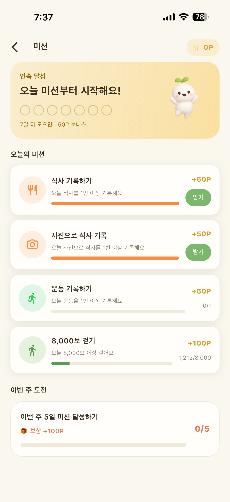

새 달력 첫 장에 적은 목록을 떠올려 보세요. 매일 만 보, 야식 끊기, 아침 챙겨 먹기, 주 3회 운동. 그리고 2월쯤 그 목록이 어떻게 됐는지도요.

"21일만 버티면 습관이 된다"는 말을 믿고 달렸는데 22일째에도 여전히 힘들었다면, 내가 이상한 게 아니에요. 실제로 사람들을 12주 동안 지켜본 연구에서는 이야기가 꽤 달랐거든요. 올해는 다짐을 늘어놓는 대신, 습관 하나로 작은 실험을 해 보는 건 어떠세요?

## 21일이라는 숫자는 어디까지 맞을까

2010년 영국 연구진은 96명에게 "아침 먹고 물 한 잔"처럼 먹기, 마시기, 움직이기 중 하나를 골라 매일 같은 상황에서 12주 동안 해 보게 했어요. 그리고 그 행동이 얼마나 생각 없이 나오는지 매일 스스로 점수를 매기게 했어요.

행동이 거의 자동이 되기까지 걸린 시간은 사람과 행동에 따라 18일에서 254일까지 크게 달랐어요. 21일보다 훨씬 오래 걸리는 경우가 흔했다는 거예요.

반가운 결과도 있었어요. 하루 빠뜨린 것이 습관이 만들어지는 과정에 큰 영향을 주지 않았어요. 한 번 놓쳤다고 처음부터 다시 시작할 필요는 없다는 뜻이에요. 그리고 이 연구를 보면 다짐이 다섯 개일 때 왜 무너지는지도 짐작이 가요. 하나가 자리 잡는 데도 이만큼 걸리니까요.

새로운 행동을 하려면 처음엔 매번 "해야지" 하고 마음먹는 힘이 필요한데, 바쁜 하루 끝에 그 힘으로 다섯 가지를 모두 챙기기는 어려워요. 습관이 되면 양치처럼 생각하지 않아도 몸이 먼저 움직여요. 그래서 하나에 힘을 모아 습관으로 만들고, 그다음을 더하는 편이 결국 더 멀리 가요.

## 실험 준비: 습관 하나, 문장 하나

준비물은 두 가지예요. 혈당 흐름과 이어진 습관 하나, 그리고 그 습관을 "만약 ~하면, ~한다" 문장으로 바꾼 것 하나요.

심리학에서는 이렇게 언제 어디서 할지까지 정해 둔 계획을 실행 의도라고 불러요. 이런 계획을 다룬 94개 연구를 모은 분석에서, 언제 어디서 할지 정한 사람들은 목표만 세운 사람들보다 목표를 이루는 정도가 중간 이상으로 높게 나타났어요. 상황이 신호가 되어 행동을 불러내기 때문이에요.

| 습관 | "만약 ~하면" 문장으로 |
|---|---|
| 식후 걷기 | 저녁 설거지를 마치면 동네 한 바퀴 |
| 채소 먼저 먹기 | 밥상에 앉으면 첫 젓가락은 나물부터 |
| 단 음료 줄이기 | 카페에 가면 첫 잔은 아메리카노나 차 |
| 앉아 있는 시간 끊기 | 회의가 끝나면 일어나서 물 뜨러 가기 |
| 일정한 잠자리 | 밤 11시 알람이 울리면 휴대폰 내려놓기 |

무엇을 고를지 막막하면 지난 한 달 그래프에서 가장 자주 높이 솟은 시간대를 떠올려 보세요. 저녁 식후가 자주 높았다면 식후 걷기, 오후 간식 뒤가 높았다면 음료 바꾸기가 첫 후보예요. 부담스러우면 더 작게 줄여도 돼요. "30분 걷기" 대신 "신발 신고 현관 나가기"처럼요. 양치, 커피, 퇴근처럼 이미 매일 하는 일 바로 뒤에 붙이면 잊을 일도 줄어요. 영국 연구에서도 매번 같은 상황에서 반복한 사람일수록 습관이 잘 자리 잡았어요.

## 4주 동안 기록할 것 세 가지

1. 달력 동그라미. 한 날엔 동그라미, 못 한 날은 그냥 비워 둬요. 이어진 줄이 눈에 보이면 끊고 싶지 않아져요.
2. 자동 점수. 일요일마다 "이번 주엔 생각하지 않고 했나?"를 1에서 5까지 스스로 매겨요. 영국 연구에서 사람들이 매일 하던 걸 일주일에 한 번으로 줄인 버전이에요.
3. 그 시간대 그래프. 습관이 걸린 시간대, 예를 들어 저녁 식후 두세 시간의 CGM 그래프를 습관을 한 날과 못 한 날로 나눠 모아 둬요.

글루밍의 미션은 식사 기록하기, 운동 기록하기, 걷기처럼 매일 할 수 있는 행동으로 이루어져 있고, 연속으로 달성하면 스탬프가 쌓여요. 고른 습관과 이어진 미션 하나를 달력 대신 써도 좋아요.

*글루밍 미션 화면 (예시)*

## 4주 뒤, 결과를 읽는 법

그래프부터 보고 싶겠지만, 먼저 자동 점수의 방향을 보세요. 1주차 2점이 4주차 3점이 됐다면 실험은 잘 가고 있는 거예요. 아직 5점이 아니어도 괜찮아요. 연구에서도 몇 달씩 걸린 사람이 많았어요.

그다음 그래프예요. 습관을 한 날과 못 한 날의 그 시간대를 나란히 놓으면 오르막 높이나 내려오는 속도에 차이가 보일 수 있어요. 차이가 뚜렷하지 않을 수도 있어요. 그날 먹은 음식과 잠, 컨디션이 함께 섞이기 때문이에요. 이번 실험의 첫 번째 목표는 그래프 모양보다 "습관이 남았는가"예요.

## 중간에 끊겼을 때 다시 잇는 법

여행, 야근, 감기처럼 흐름이 끊기는 일은 꼭 생겨요. 하루 빠진 건 괜찮다는 결과를 기억하고, 이틀 연속만 피해 보세요. 몇 주를 쉬었다면 처음 정한 "만약 ~하면" 문장으로 그대로 돌아오면 돼요. 쉬었던 기간보다 다시 돌아온 날이 더 중요해요.

## 실험이 끝나면 다음 습관을 얹어요

하나가 자리 잡으면 그 위에 다음 습관을 얹기가 쉬워요. 저녁 식후 걷기가 자리 잡았다면 그 길에 계단 오르기를 더하는 식이에요. 1년 동안 서너 개가 차곡차곡 쌓이는 게, 1월에 열 개를 시작해 2월에 모두 멈추는 것보다 훨씬 멀리 가요.

거창한 새해 다짐보다, 12월까지 이어지는 습관 하나가 더 큰 선물이 될 거예요.
