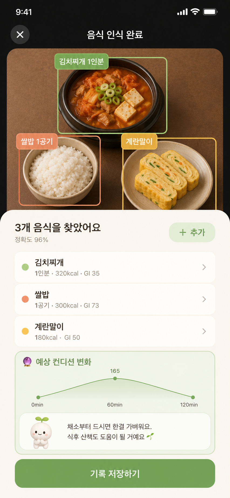

밥을 푸다가 멈칫한 적 있으세요? "이게 탄수화물 몇 g이더라" 하고 검색창을 열었다가, 결국 대충 퍼서 먹게 되는 순간이요. 매 끼니 숫자를 계산하는 건 생각보다 금방 지쳐요.

그럴 때 계산기 대신 꺼내 볼 만한 게 접시 하나예요. 담는 자리만 정해 두면 비율이 저절로 맞춰지는 방법이라, 처음 듣는 분들이 묻는 질문 순서대로 정리해 봤어요.

## 접시 나누기 식사법, 정확히 어떻게 나누나요?

미국당뇨병학회(ADA)가 소개하는 "다이어비티스 플레이트(Diabetes Plate)"는 지름 약 23cm(9인치) 접시를 기준으로 이렇게 나눠요.

- 절반: 비전분 채소. 잎채소, 브로콜리, 파프리카, 토마토처럼 탄수화물이 적고 식이섬유가 많은 채소예요.
- 4분의 1: 단백질. 생선, 닭고기, 살코기, 달걀, 두부, 콩이에요.
- 4분의 1: 질 좋은 탄수화물. 통곡물, 감자나 고구마 같은 전분 채소, 콩류, 과일, 유제품이 여기에 들어가요.
- 음료: 물이 가장 좋고, 달지 않은 차나 탄산수도 괜찮아요.

집에 있는 접시가 이보다 크면 샐러드 접시나 디저트 접시를 쓰라고 안내해요. 덮밥처럼 섞인 음식도 같은 비율을 떠올리며 덜어 담으면 돼요.

## 숫자를 안 세는데 정말 균형이 잡히나요?

혈당을 가장 직접적으로 올리는 건 탄수화물이에요. 그렇다고 탄수화물을 빼 버리면 금방 허기지고 오래 이어 가기 어려워요. 접시 나누기는 탄수화물을 없애는 대신 "4분의 1"이라는 자리를 정해 주는 방식이에요. 자리가 정해지면 양도 따라 정해져요. 밥을 덜 먹으라는 말보다 "이 칸까지만"이라는 경계가 훨씬 지키기 쉽고, 비운 자리를 채소와 단백질이 채워 주니 배고픔도 덜해요.

나머지 자리를 채운 채소의 식이섬유와 단백질은 위에서 음식이 내려가는 속도를 늦추는 데 관여한다고 알려져 있어요. 같은 밥 한 공기라도 혼자 먹을 때와 채소, 단백질과 함께 먹을 때 혈당 흐름이 다르게 나타날 수 있는 이유예요.

## 밥, 국, 반찬이 따로 나오는 한식은 어떻게 나누나요?

오히려 한식이 나누기 쉬워요. 이미 칸이 나뉘어 나오니까요.

| 칸 | 한식에서 고를 수 있는 것 |
|---|---|
| 채소 절반 | 나물 무침, 쌈 채소, 오이와 파프리카, 데친 브로콜리, 김치 조금 |
| 단백질 4분의 1 | 생선구이, 두부부침, 달걀찜, 닭가슴살, 수육 |
| 탄수화물 4분의 1 | 잡곡밥 반 공기에서 3분의 2 공기, 작은 고구마 하나 |

밥공기를 쓴다면 반찬을 먼저 넓은 접시에 덜어 놓고 밥 양을 보세요. 채소 반찬이 접시 절반을 덮고 있는지 한눈에 보여요. 국물 요리는 건더기 위주로 먹고, 채소 반찬을 따로 곁들여 절반을 채우면 돼요.

## 회사 식당이나 편의점에서도 할 수 있나요?

할 수 있어요. 눈앞에 보이지 않는 접시를 떠올리면 돼요.

1. 구내식당 식판. 가장 큰 칸에 채소 반찬을 담고, 밥은 평소보다 한 숟가락 덜 받아요.
2. 편의점 한 끼. 삼각김밥 하나에 샐러드나 컵 브로콜리, 삶은 달걀이나 두유를 더해 접시를 완성해요.
3. 덮밥과 비빔밥. 밥을 덜고 나물을 더 얹어 달라고 하거나, 채소 반찬을 하나 더 시켜요.
4. 고깃집. 쌈 채소를 넉넉히 먹고 공깃밥이나 냉면은 나눠 먹어요.

처음엔 어색해도 몇 번 해 보면 머릿속에서 접시가 저절로 나뉘어요.

## 감자, 옥수수, 과일은 어느 칸인가요?

모두 탄수화물 칸이에요. 감자, 고구마, 옥수수, 단호박은 채소처럼 보여도 전분이 많아요. 과일도 탄수화물 칸이라서, 식사에 과일을 곁들이는 날엔 밥을 조금 줄이면 균형이 맞아요. 헷갈리기 쉬운 것만 기억해 두면 나머지는 어렵지 않아요.

## 담는 것만큼 먹는 순서도 상관이 있나요?

있을 수 있어요. 2016년 일본 연구진은 2형 당뇨가 있는 사람 12명과 당뇨가 없는 성인 10명에게 같은 식사를 순서만 바꿔 먹게 했어요. 생선이나 고기를 먼저 먹고 밥을 나중에 먹은 날, 밥을 먼저 먹은 날보다 식후 혈당 상승이 완만했고 위에서 음식이 내려가는 속도도 느렸다고 보고됐어요.

그러니 접시를 나눴다면 먹을 때도 채소와 단백질 칸부터 시작해 보세요. 두 가지를 한 번에 챙기는 셈이에요.

내 밥 양이 어느 정도면 맞는지는 그래프가 먼저 알려 줘요. 글루밍에서 식사를 사진으로 기록하면 한 상의 음식을 하나씩 알아보고 음식별 탄수화물을 정리해 줘요. 접시를 나눈 날과 아닌 날의 탄수화물, 그리고 식후 CGM 그래프의 오르막을 나란히 놓고 보면 감이 와요.

*글루밍 음식 인식 화면 (예시)*

식탁에 앉기 전에 세 가지만 확인해 봐도 충분해요.

- 접시의 절반이 초록색, 빨간색, 주황색 채소로 덮여 있나요?
- 생선, 고기, 달걀, 두부 중 하나가 손바닥만큼 올라가 있나요?
- 밥이나 면, 감자, 과일이 다 합쳐 접시의 4분의 1을 넘지 않나요?

매 끼니 완벽할 필요는 없어요. 하루 한 끼, 저녁부터 접시를 나눠 보세요. 일주일쯤 지나면 밥공기를 들 때 손이 먼저 양을 알아채기 시작해요. 임신 중이거나 혈당에 영향을 주는 약을 복용 중이라면 탄수화물 양은 담당 의료진이나 영양사와 상의해 나에게 맞게 조절해 주세요.
