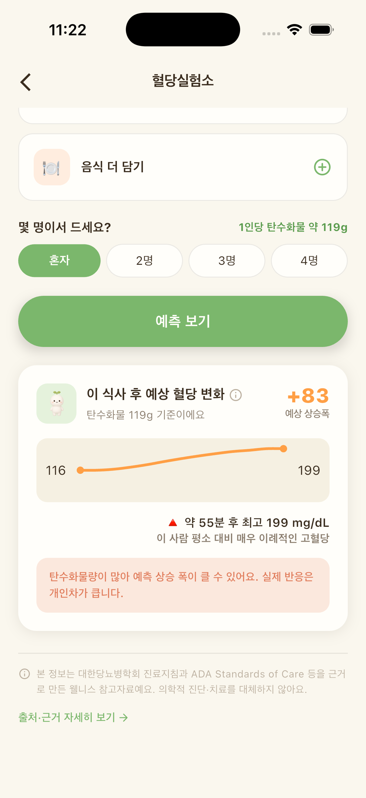

새해 첫날 아침, "떡국을 먹어야 한 살 먹는다"며 그릇이 하나씩 놓여요. 숟가락을 들다가 문득 이런 생각이 들 수 있어요. 떡도 쌀이니까 밥 한 공기랑 비슷하겠지? 국물 음식이니까 생각보다 가볍지 않을까?

떡국은 맛보다 마음으로 먹는 음식이라 포기할 필요는 없어요. 대신 떡국을 둘러싼 흔한 말들을 한 번 짚어 보면, 같은 한 그릇도 조금 다르게 담을 수 있어요.

## "떡도 쌀이니까 밥이랑 똑같다"

재료는 같아도 모양이 달라요. 가래떡은 멥쌀을 곱게 빻아 쪄서 치댄 뒤 길게 뽑아 만들어요. 쌀을 가루로 만들고 쪄서 치대는 과정을 거치기 때문에, 밥알 그대로인 밥보다 소화가 빠르게 느껴질 수 있어요.

밀도도 달라요. 떡은 밥보다 촘촘하게 뭉쳐 있어서, 같은 부피라도 생각보다 많은 탄수화물을 먹게 되기 쉬워요. 그릇에 담긴 떡 한 줌이 밥 한 공기보다 작아 보여도, 안에 든 양까지 작다고 보긴 어려워요. 그래서 떡국을 "국 한 그릇"이 아니라 "밥 한 끼"로 생각하고 담는 편이 실제와 더 가까워요. 떡국을 먹는 아침이라면 따로 밥을 곁들이지 않는 것만으로도 한 끼의 균형이 꽤 달라져요.

## "GI 숫자만 보면 떡이 괜찮은지 알 수 있다"

음식이 혈당을 얼마나 빠르게 올리는지 비교할 때 혈당지수(GI)를 많이 참고해요. 2021년에 정리된 국제 GI 표에는 4,000개가 넘는 식품이 실려 있어요. 그런데 연구진은 빵, 쌀, 감자 같은 주식도 제품과 지역에 따라 값이 다를 수 있어서 더 많은 측정이 필요하다고 덧붙였어요.

그러니 "떡의 GI는 몇"이라는 숫자 하나에 기대기보다, 한 그릇 안에 무엇을 얼마나 넣고 어떤 순서로 먹는지에 집중하는 편이 실용적이에요.

## "국물 음식이라 생각보다 양이 적다"

오히려 반대일 때가 많아요. 국물이 뜨끈하고 부드러워 꼭꼭 씹지 않고 빨리 넘기게 되거든요. 떡국 한 그릇이 금방 비워지는 이유예요.

여기에 명절 상에는 전, 잡채, 식혜처럼 탄수화물이 많은 음식이 함께 오르기 쉬워요. 떡국에 밥까지 말면 탄수화물이 두 배가 되기도 해요. 한 그릇만이 아니라 한 상 전체로 보면 양은 더 늘어나요.

국물 자체는 혈당에 주는 영향이 크지 않지만 소금이 많이 들어가요. 건더기 위주로 먹고 국물은 조금 남겨도 괜찮아요.

## "잡곡 떡으로 바꾸면 신경 쓸 게 없다"

현미 떡이나 잡곡 떡에는 통곡물이 섞여 식이섬유가 조금 더 들어가요. 하지만 곱게 빻아 만든 떡이라는 점은 같아요. 종류만 바꾸고 안심하기보다 양과 순서를 함께 챙기는 게 좋아요. 잡곡 떡을 골랐다면 그건 좋은 출발이고, 거기에 떡 양을 조금 줄이고 건더기를 늘리는 것까지 더해 보세요.

## "떡국은 떡부터 먹어야 제맛이다"

뜨끈한 떡부터 한 입 먹고 싶은 마음은 충분히 이해돼요. 맛으로는 그럴지 몰라도, 흐름으로는 순서를 바꿔 볼 만해요. 2016년 일본 연구진은 2형 당뇨가 있는 사람과 건강한 사람에게 같은 식사를 순서만 바꿔 먹게 했어요. 생선이나 고기를 먼저 먹고 15분 뒤 밥을 먹었을 때, 밥을 먼저 먹었을 때보다 식후 혈당 상승이 완만했고 위에서 음식이 내려가는 속도도 느렸다고 보고됐어요.

떡국이라면 고기와 달걀 지단, 함께 나온 나물과 김치를 먼저 먹고 떡은 뒤로 미루는 거예요. 가족과 이야기를 나누며 천천히 먹으면 속도도 자연스럽게 느려져요. 첫 숟가락을 건더기로 뜨는 것, 이 작은 순서 하나가 생각보다 어렵지 않으면서 챙기기 좋은 습관이에요. 떡이 그릇 바닥에 조금 남는다면 그대로 두어도 괜찮아요.

## 그래서, 올해 떡국은 이렇게 담아 봐요

| 바꿔 볼 것 | 이렇게 해 보세요 |
|---|---|
| 떡의 양 | 평소의 3분의 2 정도, 대신 건더기를 늘려요 |
| 단백질 | 소고기 양지, 달걀을 넉넉히 |
| 채소 | 대파, 표고버섯, 시금치를 넣거나 나물 반찬을 곁들여요 |
| 떡만둣국 | 만두와 떡을 합한 양을 평소 떡 양에 맞춰요 |

냄비에서 국자로 뜨면 양을 가늠하기 어려우니, 떡을 먼저 그릇에 덜어 보고 국물을 부어요. 먹고 나서는 설거지나 세배 다니며 걷기, 동네 한 바퀴로 가볍게 움직이고, 점심과 저녁은 채소와 단백질 위주로 균형을 맞춰요. 남은 가래떡은 한 번 먹을 양씩 나눠 냉동해 두고, 꺼낼 땐 채소와 달걀, 고기를 듬뿍 넣어 한 끼 식사로 만들면 며칠씩 간식처럼 집어 먹는 일을 줄일 수 있어요.

떡 양을 정하기 어렵다면 먹기 전에 글루밍 혈당실험소에 담아 떡 양을 바꿔 가며 예상 흐름을 비교해 보세요. 먹은 뒤엔 CGM 그래프에서 오르막 높이와 내려오는 시간을 확인해 두면, 내년 설엔 나에게 맞는 떡 양을 이미 알고 있을 거예요.

*글루밍 혈당실험소 예측 화면 (예시). 예측은 개인 기록에 따라 달라지는 참고값이에요.*

임신 중이거나 혈당에 영향을 주는 약을 복용 중이라면, 명절 음식의 양은 담당 의료진과 미리 이야기해 두면 마음이 편해요. 새해 첫 그릇, 따뜻하게 즐기세요.
