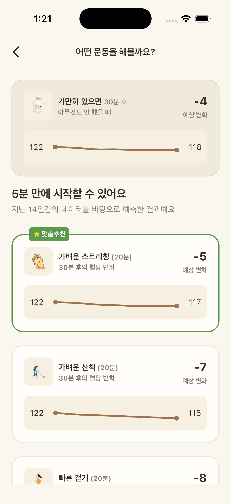

밥을 먹고 나면 소파에 기대고 싶어지죠. 그런데 식사 직후의 짧은 움직임이 혈당 흐름과 꽤 관련이 있다는 연구들이 있어요. 오늘은 "식후 걷기"가 왜 자주 이야기되는지, 그리고 부담 없이 시작하는 방법을 정리해 볼게요.

## 식사 후 혈당은 왜 오를까

음식 속 탄수화물은 소화되면서 포도당으로 바뀌고, 혈액으로 흡수돼요. 그래서 식사 후에는 누구나 혈당이 오르고, 시간이 지나면 다시 내려오는 흐름을 보여요. 이 흐름이 얼마나 가파르게, 얼마나 오래 이어지는지는 먹은 음식의 종류와 양, 그날의 컨디션, 그리고 식사 후에 무엇을 했는지에 따라 달라질 수 있어요.

몸을 움직이면 근육이 에너지원으로 포도당을 끌어다 써요. 식사 직후처럼 혈액 속 포도당이 늘어나는 시간에 가볍게 움직이면, 그만큼 근육이 포도당을 쓰는 데 참여하게 되는 셈이에요.

## 연구에서는 무엇을 봤을까

- 식후에 나눠 걷기: 2형 당뇨가 있는 성인을 대상으로 한 무작위 교차 연구에서는, 하루 30분을 한 번에 걷는 것보다 매 끼니 후 10분씩 나눠 걷는 것이 식후 혈당이 덜 오르는 경향과 관련이 있었어요. 특히 저녁 식사 후 걷기에서 차이가 두드러졌다고 보고됐어요.
- 오래 앉아 있는 시간 끊기: 성인을 대상으로 한 여러 연구를 모은 메타분석에서는, 오래 앉아 있는 중간중간 가벼운 걷기를 넣었을 때 계속 앉아 있을 때보다 식후 혈당과 인슐린 반응이 완만해지는 경향이 관찰됐어요.
- 생활 지침: 미국당뇨병학회(ADA)의 생활습관 지침에서도 혈당 관리를 위해 오래 앉아 있는 시간을 30분마다 끊어 주는 것을 권하고 있어요.

연구마다 대상자와 조건이 다르고, 개인의 반응도 저마다 달라요. 그래서 "몇 분 걸으면 혈당이 얼마 내려간다" 같은 숫자로 기대하기보다는, 식후에 앉아만 있지 않는 습관으로 생각하는 게 좋아요.

## 일상에서 해볼 수 있는 방법

1. 식사 후 15–30분 안에 일어나기. 거창한 운동이 아니어도 괜찮아요. 설거지, 집 정리, 동네 한 바퀴처럼 몸을 일으키는 것부터 시작해요.
2. 10분 정도, 대화할 수 있는 속도로. 숨이 차지 않고 말할 수 있을 정도의 가벼운 걷기면 충분해요.
3. 저녁 식사 후부터. 하루 중 활동이 가장 적어지기 쉬운 시간이라, 한 끼만 고른다면 저녁이 시작하기 좋아요.
4. 회사에서는 짧게 자주. 점심 후 계단 이용하기, 30분마다 잠깐 일어나 물 마시러 가기도 좋은 방법이에요.

몸 상태에 따라 무리가 될 수 있는 경우도 있어요. 임신 중이거나, 혈당에 영향을 주는 약을 복용 중이거나, 관절·심장 등 건강상 주의가 필요하다면 새로운 운동 습관을 시작하기 전에 담당 의료진과 먼저 상의해 주세요.

## 내 몸의 반응은 직접 확인해 보세요

같은 메뉴, 같은 걷기라도 사람마다 혈당 흐름은 다르게 나타나요. 연속혈당측정(CGM)을 쓰고 있다면 "걸은 날"과 "앉아 있던 날"의 식후 그래프를 나란히 비교해 보세요. 내 몸이 어떻게 반응하는지 알게 되면, 습관을 이어갈 이유도 훨씬 분명해져요.

글루밍에서는 식사 후 산책을 고르기 전에, 내 혈당 흐름이 어떻게 달라질지 미리 그려볼 수 있어요.

*글루밍 운동 시뮬레이션 화면 (예시). 예상 흐름은 개인 기록에 따라 달라지는 참고값이에요.*
