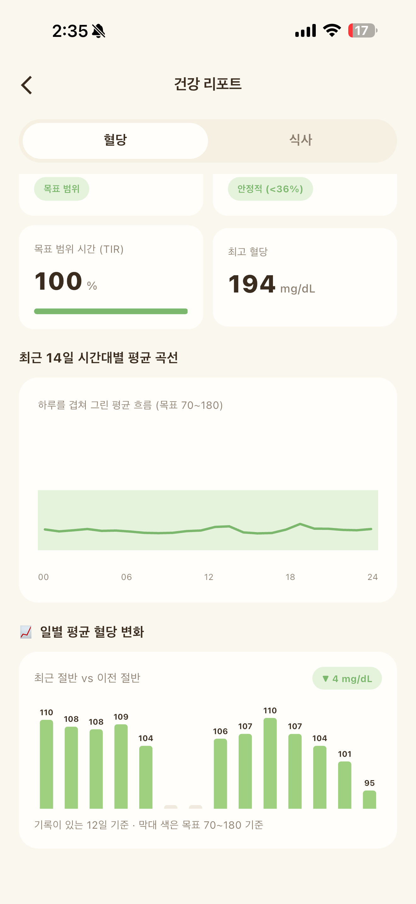

연속혈당측정(CGM)을 쓰면 하루에도 몇 번씩 그래프를 열게 돼요. 점심 뒤 솟은 봉우리를 보고 "오늘은 망했다", 잔잔한 저녁을 보고 "오늘은 잘했다." 그렇게 하루씩 점수를 매기다 보면 정작 일요일 밤엔 무엇이 반복됐는지 기억나지 않아요.

한 주를 모아 보면 하루에는 안 보이던 것이 보여요. 다만 어떤 한 주를 보냈느냐에 따라 리포트에서 먼저 펼쳐 볼 곳이 달라요. 상황별로 나눠 봤어요.

## 먼저, 한 주 숫자를 어디까지 믿을까

CGM 데이터 읽는 법에는 전문가들이 모여 만든 국제 합의문이 있어요. 2017년 합의문은 여러 날의 데이터를 겹쳐 하루 그래프 하나로 요약한 표준 보고서(AGP, 보행 혈당 프로파일)를 보길 권했어요. 날짜가 달라도 같은 시간대를 모아 보면 반복되는 흐름이 드러나기 때문이에요.

2019년 합의문은 목표 범위 안에 머문 시간(TIR), 변동성(CV), 평균 혈당 같은 지표를 정리했고, 이런 지표를 평가할 때는 14일 정도의 데이터를, 그중 70% 이상 측정된 상태로 보길 권했어요.

이 기준에 비추면 일주일은 숫자를 판정하기엔 조금 짧아요. 그래서 주간 리포트는 성적표보다 "다음 주에 무엇을 해 볼지 고르는 메모"로 읽는 게 좋아요. 평가는 2주, 한 달씩 쌓인 흐름으로 하고, 한 주는 행동을 고르는 데 써요. 사흘 전 점심은 대부분 기억나지만 한 달 전 화요일 점심은 떠올리기 어렵다는 점에서도, 일주일은 그래프와 기억을 이어 보기 좋은 길이예요.

## 별일 없던 평범한 한 주였다면

가장 돌아보기 좋은 주예요. 일주일을 겹친 시간대별 평균 곡선부터 보세요. 매일 비슷한 시간에 솟는 봉우리가 있다면 우연이 아니라 습관일 가능성이 커요. 점심 뒤인지, 저녁 뒤인지, 늦은 밤인지 하나만 찾아요.

그다음 혈당을 많이 올린 끼니 몇 개를 훑어봐요. 면, 빵, 달달한 음료처럼 겹치는 게 보이면 다음 주 실험 거리가 생긴 거예요. 메뉴는 같은데 어떤 날은 높고 어떤 날은 낮았다면, 그날 먹은 시간이나 식후에 움직였는지를 떠올려 보세요. 하루의 혈당은 먹은 것, 잠, 스트레스, 움직임이 한데 섞인 결과라서, 메뉴 말고 다른 쪽에 실마리가 있을 때도 많아요.

## 연말 모임이 몰린 주였다면

숫자가 지난주보다 나빠졌을 수 있어요. 실패한 게 아니에요. 모임이 몰린 주, 잠을 설친 주, 컨디션이 안 좋은 주에 흐름이 출렁이는 건 자연스러워요.

이런 주엔 평균보다 일별 평균 변화를 보세요. 모임이 있던 날만 튀었는지, 다음 날까지 이어졌는지가 더 쓸모 있는 정보예요. 다음 날 바로 돌아왔다면 그 자체로 잘 지낸 한 주예요. 숫자가 바뀐 이유를 스스로 떠올릴 수 있다면, 그것만으로도 의미 있는 돌아보기를 한 거예요. 이런 주의 실험은 거창할 필요 없이 "모임 다음 날 아침은 평소처럼 먹기" 정도면 충분해요.

## 평일은 잔잔한데 주말만 출렁였다면

평일과 주말을 나눠 보면 차이가 선명해지는 경우가 많아요. 주말 아침이 늦어지면서 아침과 점심이 한 번에 몰리거나, 오래 앉아 있는 시간이 길어졌을 수 있어요. 다음 주 실험은 "주말에도 비슷한 시간에 아침 먹기"처럼 주말 하루에만 거는 걸로 골라요.

## 잘 지낸 것 같은데 숫자가 별로라면

평균만 보고 있진 않은지 확인해 보세요. 평균은 높은 값과 낮은 값이 섞여 가려지기 쉬워서, 평균이 비슷한 두 주라도 한 주는 잔잔하고 다른 한 주는 크게 오르내렸을 수 있어요. TIR과 CV를 같이 보고, 지난주와 비교해 방향만 확인해요.

그리고 그래프가 가장 잔잔했던 하루를 골라 그날 무엇을 먹고 어떻게 움직였는지 적어 두세요. 실패보다 성공에서 배울 게 더 많아요.

## 센서가 빠졌거나 기록이 띄엄띄엄이라면

빈 시간이 많으면 숫자가 실제 한 주를 다 보여 주지 못해요. 합의문이 측정된 시간을 함께 따지는 이유예요. 이런 주엔 숫자 비교는 건너뛰고, 기록이 남은 날의 시간대별 곡선만 가볍게 봐요.

## 어떤 주였든, 메모는 한 줄씩

| 이번 주에 본 것 | 다음 주에 해 볼 것 |
|---|---|
| 저녁 식후 오르막이 가장 높았어요 | 저녁 먹고 설거지 후 10분 걷기 |
| 주말 아침 흐름이 출렁였어요 | 주말에도 비슷한 시간에 아침 먹기 |

실험은 한 번에 하나만 바꿔요. 걷기와 밥 양 줄이기를 동시에 시작하면 무엇이 차이를 만들었는지 알기 어렵거든요. 남길 건 남기고 아닌 건 내려놓다 보면, 몇 달 뒤엔 나에게 맞는 습관 목록이 생겨요.

글루밍 건강 리포트의 혈당 탭에는 평균 혈당, CV, TIR, 최고 혈당과 함께 최근 7일 시간대별 평균 곡선, 일별 평균 변화가 한 화면에 모여 있고, 식사 탭에서는 혈당을 많이 올린 끼니를 모아 볼 수 있어요. 일요일 저녁 5분이면 두 탭을 넘기기에 충분해요.

*글루밍 건강 리포트 화면 (예시)*

리포트 숫자는 스스로 습관을 돌아보기 위한 참고 자료예요. 걱정되는 패턴이 계속 보이거나, 임신 중이거나 혈당에 영향을 주는 약을 복용 중이라면 리포트를 들고 담당 의료진과 이야기해 보세요.
