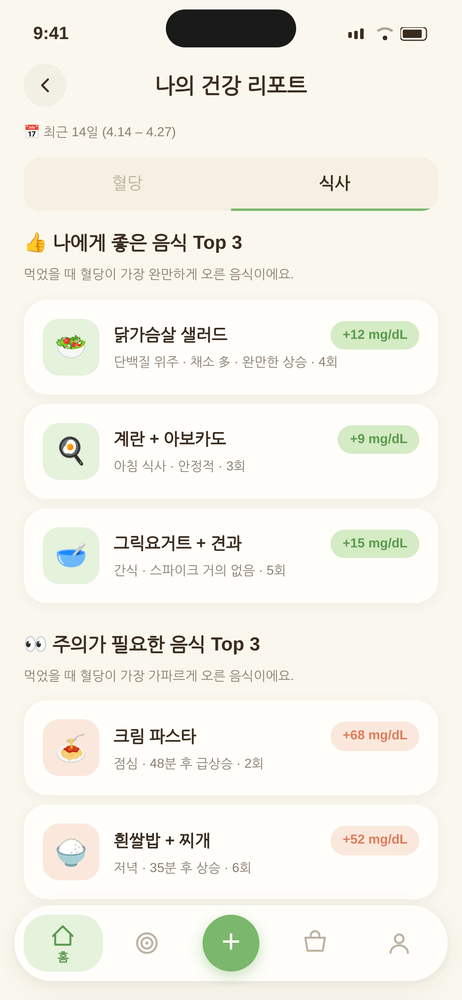

휴대폰 사진첩을 넘기다 보면 1년 전 오늘이 불쑥 나올 때가 있어요. 혈당 기록도 비슷해요. 올해 남긴 식사 사진, 걸음 수, CGM 그래프를 한 번에 넘겨 보면 "내가 이랬구나" 싶은 장면이 꽤 많아요.

올해 처음 혈당을 챙기기 시작했든, 몇 년째 이어 왔든 상관없어요. 새해 계획을 세우기 전, 12월 31일 하루를 기록과 함께 보내 보는 장면을 따라가 볼게요.

## 오전 9시, 커피를 내리며 기록을 열어요

거창한 분석은 필요 없어요. 따뜻한 차나 커피 한 잔, 그리고 30분이면 충분해요.

기록을 다시 보는 게 왜 도움이 될까요. 식사, 운동, 체중을 스스로 기록하는 것을 다룬 22개 연구를 모은 체계적 문헌고찰에서는, 꾸준히 기록한 사람일수록 체중 관리 결과가 좋은 경향이 일관되게 나타났어요. 다만 연구 방법에 한계가 있어 근거 수준은 아직 강하지 않다고 연구진은 덧붙였어요.

기록이 마법을 부리는 건 아니에요. 다시 보면서 "이럴 때 이렇게 되는구나" 하고 알아차리는 순간, 다음 행동을 고를 수 있게 되는 거예요. 매일 기록할 땐 하루하루가 점처럼 흩어져 보이지만, 1년을 이어 놓으면 점들이 선이 돼요. 한 해의 마지막 날은 그 선을 가장 길게 그려 볼 수 있는 날이에요.

시작은 1월 기록부터예요. 처음 기록을 남겼던 날의 식사 사진을 보면, 지금과 무엇이 달라졌는지 저절로 비교가 돼요.

## 오후 2시, 계절별로 넘겨 보기

1년치를 하루씩 보면 끝이 없어요. 전문가들이 정리한 CGM 국제 합의문은 목표 범위 안 시간(TIR), 변동성(CV), 평균 혈당을 함께 보고, 이런 지표는 14일 정도의 데이터로 평가하길 권해요. 그러니 한 해를 볼 땐 2주나 한 달 단위로 넘기는 게 좋아요.

이렇게 넘기다 보면 하루치 기록으론 안 보이던 것들이 보여요.

- 계절의 흐름. 여름엔 시원한 면, 겨울엔 따뜻한 떡과 빵처럼 자주 먹는 음식이 바뀌고 흐름도 따라 바뀌어요.
- 바쁜 시기. 마감이 몰린 달, 연말 모임이 이어진 주에 그래프도 함께 흔들렸는지 보여요.
- 습관이 자리 잡은 순간. 억지로 하던 식후 걷기가 어느새 당연해진 시점이 기록에 남아 있어요.

계절마다 한 줄씩만 메모해 두면 오후 일이 쉬워져요. "봄엔 점심 뒤가 높았다", "가을엔 걸음 수가 늘었다"처럼요. 이 메모가 다음 순서의 질문에 답할 재료가 돼요.

## 오후 4시, 다섯 가지 질문에 한두 줄씩

창가에 앉아 아래 질문에 짧게 답해 봐요.

1. 올해 가장 잔잔했던 달은 언제였나요? 잠, 식사 시간, 걸음 수 중 무엇이 달랐는지 떠올려 봐요.
2. 나에게 잘 맞았던 음식 세 가지는? 먹고 나서 그래프가 편안했던 메뉴예요. 새해 장보기 목록이 돼요.
3. 나를 자주 출렁이게 한 건? 음식일 수도, 늦은 저녁이나 짧은 잠일 수도 있어요. 탓하기보다 "나는 이럴 때 이렇구나"로 적어요.
4. 끝까지 이어 간 습관은? 작아도 괜찮아요. 1년을 버틴 습관이라면 이미 내 것이에요.
5. 새해로 가져갈 것 하나는? 잘한 것 하나를 이어 가거나, 아쉬웠던 것 하나를 새로 시작해요.

답이 바로 떠오르지 않는 질문은 비워 둬도 괜찮아요. 저녁에 기록을 조금 더 넘기다 보면 생각나기도 해요.

## 저녁 7시, 크게 출렁였던 날을 다시 보면

저녁을 먹고 나서 유난히 높았던 날들을 다시 펼쳐 봐요. 대부분 이유가 있었을 거예요. 아팠던 날, 소중한 사람과 축하했던 날, 마음이 힘들었던 날이요.

기록은 나를 평가하는 성적표가 아니라 나를 이해하는 일기예요. 기록이 비어 있는 달이 있어도 괜찮아요. 그때 왜 멈췄는지, 무엇이 다시 시작하게 했는지 떠올려 보면 새해에 기록을 이어 가는 나만의 방법이 보여요. 너무 바빴다면 기록을 더 간단하게, 지루했다면 친구나 가족과 함께하는 쪽으로요.

## 밤 10시, 리포트로 답 맞춰 보기

글루밍 건강 리포트의 식사 탭에서는 자주 먹은 음식과 혈당을 많이 올린 끼니를 모아 볼 수 있어요. 혈당 탭의 평균, 변동성, 목표 범위 시간과 함께 넘기면 오후에 적은 두 번째, 세 번째 질문의 답과 맞는지 확인해 볼 수 있어요. 한 해 동안 미션으로 모은 글루밍즈 친구들을 둘러보는 것도 작은 즐거움이에요.

*글루밍 건강 리포트 식사 탭 (예시)*

## 밤 11시 50분, 새해로 가져갈 한 줄

다섯 번째 질문의 답을 달력 첫 장에 옮겨 적어요. 목표를 여럿 세우기보다 이 한 줄을 "저녁 설거지를 마치면 동네 한 바퀴"처럼 언제, 어디서 할지까지 구체적으로 써 두면 1월에 떠올리기 쉬워요. 건강검진 결과지가 있다면 그 옆에 함께 끼워 두세요. 기록을 돌아보다 걱정되는 흐름이 계속 보였다면, 새해 첫 건강검진이나 진료 때 기록을 들고 가서 의료진과 이야기해 보세요.

1년 동안 기록을 남겼다는 것만으로도 충분히 칭찬받을 일이에요. 내년 이맘때 오늘 적은 한 줄을 다시 펼쳐 보면, 한 해 동안 얼마나 걸어왔는지 보일 거예요. 올 한 해도 수고 많으셨어요.
